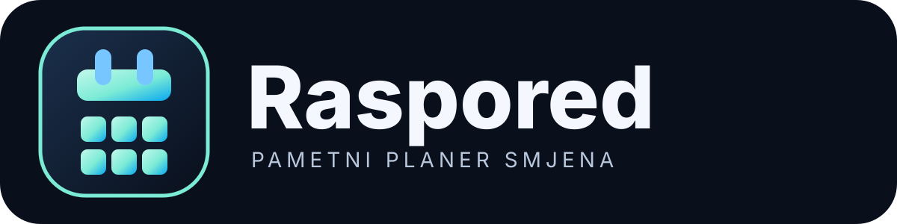
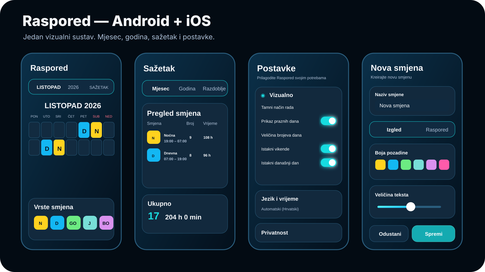
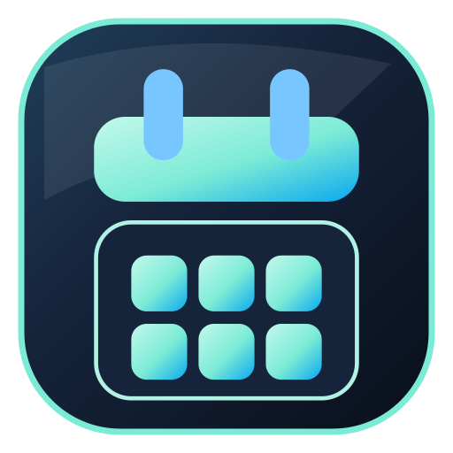

  

<h1 align="center">Vaše vrijeme. Vaš raspored.</h1>

  <strong>Dvije aplikacije za jasniji svaki dan — na Androidu i iPhoneu.</strong> 
  Organizirajte smjene, pratite vrijeme i planirajte obveze u preglednom tamnom sučelju.

  <a href="https://github.com/bren-wp/SHIFTERICA/releases/latest"><strong>Preuzmite aplikacije</strong></a>
  &nbsp;·&nbsp; <a href="#dva-na%C4%8Dina-planiranja">Odaberite aplikaciju</a>
  &nbsp;·&nbsp; <a href="#izgled-i-snimke">Pogledajte izgled</a>
  &nbsp;·&nbsp; <a href="#privatnost">Privatnost</a>

---

## Dva načina planiranja

| | **Raspored** | **Raspored_app** |
|---|---|---|
| Za koga? | Za osobe koje prate radne smjene i sate | Za svakoga tko želi vlastiti kalendar |
| 📅 Planiranje | Mjesečni i godišnji pregled smjena | Mjesečni i tjedni kalendar |
| ✨ Personalizacija | Vlastite smjene, boje i postavke | Slobodni nazivi, boje, događaji i napomene |
| ⏱️ Vrijeme | Evidencija rada, odmora i prekovremenih | Neobavezna vremena, uključujući preko ponoći |
| 💶 Financije | Informativna procjena plaće | Bez obračuna plaće i nametnutih profila |
| 🔒 Pristup | Bez obveznog korisničkog računa | Bez računa, oglasa i praćenja |
| 📱 Platforme | Android / iOS | Android / iOS |

### Raspored — svaki sat na svojem mjestu

Od dnevnih i noćnih smjena do godišnjeg odmora i ukupno odrađenih sati: sve je povezano u jedan pregled. Pratite potvrđenu isplatu odvojeno od **informativne procjene plaće**, organizirajte svoje smjene i koristite podsjetnike prema dopuštenjima uređaja.

### Raspored_app — sloboda planiranja

Otvorite kalendar, odaberite datum i upišite što vam je važno. Dodajte više događaja za isti dan, uredite ili duplicirajte zapise, pretražite napomene i promijenite raspored bez nametnutih obrazaca. Birajte mjesečni ili tjedni prikaz; aplikacija pamti vaš izbor. JSON sigurnosne kopije možete izvesti i uvesti na Androidu i iOS-u.

## Izgled i snimke

  

*Gornji prikaz je ilustracija dizajna, a ne snimka s uređaja.* Stvarne snimke zaslona nastaju tijekom provjera na iOS Simulatoru i dostupne su u artefaktima GitHub Actions:

- <a href="https://github.com/bren-wp/SHIFTERICA/actions/runs/38474490229/artifacts/11853412967">Stvarne snimke — Raspored (iOS Simulator)</a>
- <a href="https://github.com/bren-wp/SHIFTERICA/actions/runs/38474490229/artifacts/11853642876">Stvarna snimka — Raspored_app (iOS Simulator)</a>

*GitHub Actions artefakti imaju ograničeno trajanje. Najnovije snimke možete pronaći u <a href="https://github.com/bren-wp/SHIFTERICA/actions/workflows/ci.yml">provjerama izdanja</a>.*

## Jednostavno korištenje

**Brz unos.** Otvorite željeni datum, dodajte zapis i nastavite s danom. **Pregled na prvi pogled.** Prepoznatljive boje smjena i jasne oznake izdvajaju ono što je važno. **Pouzdane kopije.** U univerzalnom kalendaru sami birate kada i kamo izvozite podatke.

## Privatnost

Vaši rasporedi ostaju pod vašom kontrolom. Aplikacije ne zahtijevaju registraciju i nemaju oglasne trackere. Univerzalni kalendar čuva zapise na uređaju; njegove korisnički izvezene JSON datoteke **nisu šifrirane**, stoga ih čuvajte na sigurnom mjestu. Informacije o privatnosti i uvjetima korištenja dostupne su u postavkama Raspored_app.

## Preuzimanje

Obje aplikacije distribuiraju se odvojeno u okviru izdanja. Odaberite paket prema platformi i aplikaciji na stranici **[GitHub Releases](https://github.com/bren-wp/SHIFTERICA/releases/latest)**.

**Važno:** Android APK/AAB paketi u postojećem distribucijskom sustavu označeni su kao *debug*, a iOS IPA/XCArchive paketi kao *unsigned*. Za distribuciju putem Google Playa i App Storea potrebni su produkcijsko potpisivanje, odgovarajući računi i završne provjere.

## Brendigo

  

Razvija **Brendigo**. Fokus je na jednostavnosti, preglednosti, privatnosti i svakodnevnoj praktičnosti.

Detaljni opisi mogućnosti, tehnička dokumentacija i postupci izrade: <a href="docs/PRODUCT_AND_BUILD_GUIDE.md">Prošireni vodič</a>. Informacije o zasebnom kalendaru: <a href="kalendar/README.md">Raspored_app</a>.
